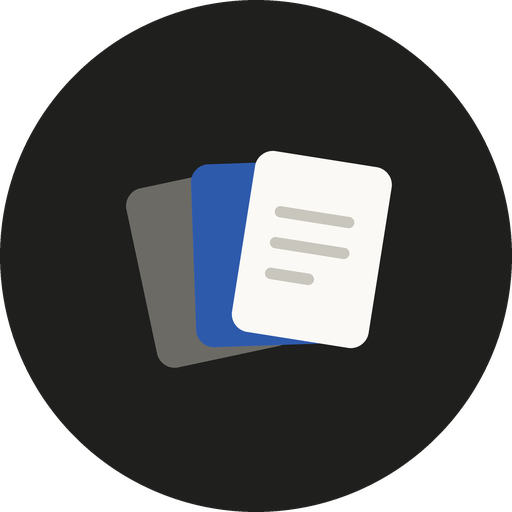

<div align="center">



# Folio

**Open any file. Offline. Nothing collected.**

A free Android app that opens PDFs, Word, Excel, PowerPoint, text, code, images, music, video and ZIP files, and edits the text ones. No ads, no account, and no internet permission.

[](https://github.com/vishalsolanki-v/Folio/releases/latest)
[](#download)
[](#privacy-by-construction)
[](#privacy-by-construction)
[](LICENSE)

[**Download the APK**](https://github.com/vishalsolanki-v/Folio/releases/latest) ·
[Website](https://www.vishalsolanki.online/apps/folio) ·
[Privacy policy](docs/privacy-policy.md)

</div>

<p align="center">
  
  
  
  
  
</p>

---

## Why Folio exists

Most file viewers on the Play Store want storage access, network access, an account and a spot for ads, just to show you a PDF someone sent on WhatsApp. Folio does the same job with none of that. Tap a file in WhatsApp, Gmail, Files or Downloads, choose Folio, and it opens.

## Privacy by construction

These aren't settings you have to trust. Folio is built this way:

| | |
|---|---|
| 🚫 **No internet permission** | `INTERNET` and `ACCESS_NETWORK_STATE` are removed from the merged manifest. Android itself stops Folio from going online. |
| 🔐 **No permissions at all** | No storage access. Folio sees only the files you open with it, pick in it, or the folders you add yourself. |
| 📵 **Nothing collected** | No account, analytics, ads or crash-reporting service. Your Recents and settings live only on your phone. |
| ✉️ **Feedback is opt-in** | "Send feedback" and the crash prompt open a draft in *your* email app. You read it, edit it, or bin it. |
| 🧹 **One-tap cleanup** | Settings → *Clear recents and copies* deletes everything Folio keeps. Uninstalling removes the rest. |

The full policy is in [`docs/privacy-policy.md`](docs/privacy-policy.md).

## What it opens

| Type | Formats | Editable |
|---|---|:---:|
| 📄 Documents | PDF (search, zoom, passwords), Word `.docx` | |
| 📊 Spreadsheets | Excel `.xlsx`, CSV, TSV | CSV, TSV |
| 📽️ Presentations | PowerPoint `.pptx`, with an outline view | |
| 📝 Text and notes | TXT, Markdown, logs, subtitles, contacts `.vcf`, calendar `.ics` | ✅ |
| 💻 Code and data | JSON, XML, YAML, HTML, and 40+ languages with syntax colours | ✅ |
| 🖼️ Images | JPEG, PNG, WebP, GIF, HEIC, AVIF, SVG, BMP | |
| 🎵 Audio and video | MP3, M4A, FLAC, WAV, Ogg, voice notes, MP4, MKV, WebM, MOV | |
| 🗜️ Archives | ZIP: browse it and open what's inside | |

**Folio edits only what it can't break.** Text, Markdown, CSV, code and web pages get an Edit button, with drafts that survive a crash. Word, Excel and PowerPoint stay view-only, so their layout never gets damaged.

### And the everyday stuff

- Recents with search, filters, sort, pins and multi-select
- Folders you add yourself, and new text files from the home screen
- Light, Sepia and Dark paper for documents; Light, Dark and Black app themes
- Share, rename, or open with another app, from the viewer or from Recents
- Files from WhatsApp or email stay in Recents even after the sending app takes them back (Folio keeps a private copy, up to 300 MB, and you can turn that off)

## Download

Folio ships as a signed APK on [GitHub Releases](https://github.com/vishalsolanki-v/Folio/releases/latest).

| | |
|---|---|
| **Version** | 1.0.0 (1 November 2026) |
| **Needs** | Android 8.0 (API 26) or newer |
| **Size** | 24.8 MB |
| **SHA-256** | `9d4ce51d4fd977130471f4058a7abb69fdc721a7489f4395797f937f4a0d9f17` |

Check the download before installing:

```sh
sha256sum Folio-1.0.0.apk
```

### Installing

Apps from outside the Play Store show a few warnings the first time. Here's each one and what to tap.

1. **Download the APK** on your phone. Chrome says *"File might be harmful"*. That's its standard warning for every app file, not something it found in Folio. Tap **Download anyway**. If it sits at 100%, check Chrome → Downloads, or use another browser such as Brave or Firefox.
2. **Open it** when the download finishes, or find `Folio-1.0.0.apk` in Chrome → Downloads or Files → Downloads.
3. **Allow your browser to install apps.** The first time, Android says *"Permission required"*. Tap **Settings**, turn on **Allow from this source**, then go back. You can turn it off again afterwards.
4. **Install.** Google Play Protect says *"App scan recommended"* because it hasn't seen Folio before. Tap **Scan app** (Google checks it, then it installs), or **More details → Install without scanning**.

<p>
  
  
  
  
  
</p>

### Updates

- **From the app:** *Settings → Check for updates* opens the Folio page in your browser and tells you if a newer version exists. Folio itself never goes online.
- **Automatically:** [Obtainium](https://obtainium.imranr.dev/) watches GitHub releases and installs updates for you. Add `https://github.com/vishalsolanki-v/folio` as an app.
- **Get notified:** watch the [releases](https://github.com/vishalsolanki-v/Folio/releases) or subscribe to the [releases feed](https://github.com/vishalsolanki-v/Folio/releases.atom).

Install a new APK over the old one: your Recents and settings stay. Don't uninstall first unless you want a fresh start.

## How it's built

Kotlin and Jetpack Compose (Material 3), one app module plus a baseline-profile module. Recents live in Room and settings in DataStore.

**Fast to open:** 0.23–0.32 s from tap to file on screen, measured across file types on a Motorola Edge 50.

```
app/src/main/java/com/folio/app/
├── core/          data (Room, DataStore), design system, file access, shared viewer chrome
├── feature/       home · folder · viewer · editor · settings
├── formats/       one package per file family (below)
└── navigation/
```

Each file family has its own renderer:

| Package | Renders with |
|---|---|
| `formats/pdf` | PDFium, the engine Chrome uses, through [PdfiumAndroid](https://github.com/johngray1965/PdfiumAndroidKt) |
| `formats/docx` | [mammoth](https://github.com/mwilliamson/java-mammoth) (DOCX to HTML), shown in a locked-down WebView |
| `formats/sheet` | Folio's own `.xlsx` reader: ZIP and a streaming XML pull parser |
| `formats/slides` | Folio's own `.pptx` reader, with slide images through Coil |
| `formats/text` | [Sora Editor](https://github.com/Rosemoe/sora-editor) with TextMate grammars, plus [Markdown Renderer](https://github.com/mikepenz/multiplatform-markdown-renderer) for previews |
| `formats/image` | [Coil 3](https://coil-kt.github.io/coil/) and [Telephoto](https://github.com/saket/telephoto) for zoom |
| `formats/media` | [Media3 ExoPlayer](https://developer.android.com/media/media3) |
| `formats/archive` | `java.util.zip` |

WebView pages load with no base URL and only `data:` sub-resources. Every native library is 16 KB page-aligned, and dependency licences are checked at build time with [licensee](https://github.com/cashapp/licensee) and listed in the app with [AboutLibraries](https://github.com/mikepenz/AboutLibraries).

## Build from source

You need JDK 17 and the Android SDK (compile SDK 37).

```sh
git clone https://github.com/vishalsolanki-v/Folio.git
cd Folio

./gradlew testDebugUnitTest      # unit tests
./gradlew lintDebug :app:licensee
./gradlew assembleDebug          # app/build/outputs/apk/debug/
```

Release builds read the signing key from a git-ignored `keystore.properties` in the project root. Without it, `assembleRelease` signs with the debug key, so you can test a release build locally. The full release checklist is in [`docs/release.md`](docs/release.md).

## Project docs

| File | What's in it |
|---|---|
| [`docs/plan.md`](docs/plan.md) | The original build plan, milestone by milestone |
| [`docs/decisions.md`](docs/decisions.md) | Every deviation from the plan, one line each, with the reason |
| [`docs/release.md`](docs/release.md) | How to cut a release, plus the Play Store draft |
| [`docs/privacy-policy.md`](docs/privacy-policy.md) | The privacy policy |

## Questions

**Why isn't it on the Play Store?**
Publishing there needs a paid developer account. Folio may go there later. Until then, [the Folio page](https://www.vishalsolanki.online/apps/folio) and this repository are the only official places to get it.

**How do I know it's safe?**
Folio has no internet permission, so it can't send anything anywhere. Check *Settings → Apps → Folio → Permissions* on your phone: it shows none. Each release lists its SHA-256 checksum so you can confirm your download matches. And the code is all here.

**Can it edit Word, Excel or PowerPoint files?**
No. It shows them, but editing would risk breaking their layout, so they're view-only. Text, Markdown, CSV, code and web pages can be edited and saved.

**Does it need storage access?**
No. It only sees files you open with it, pick inside it, or folders you add yourself.

## Feedback

Found a file Folio can't open, or something you'd like it to do? Use *Settings → Send feedback* in the app, [open an issue](https://github.com/vishalsolanki-v/Folio/issues), or email **workwithvishalsolanki@gmail.com**.

## License

Folio is licensed under the [Apache License 2.0](LICENSE).

<div align="center">
<sub>Built by <a href="https://www.vishalsolanki.online">Vishal Solanki</a>, a freelance Next.js developer in Noida.</sub>
</div>
